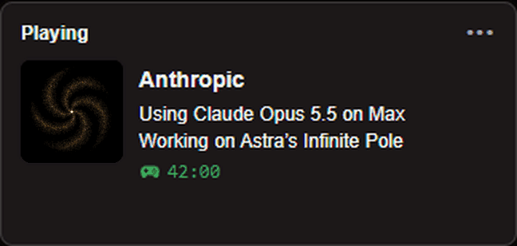
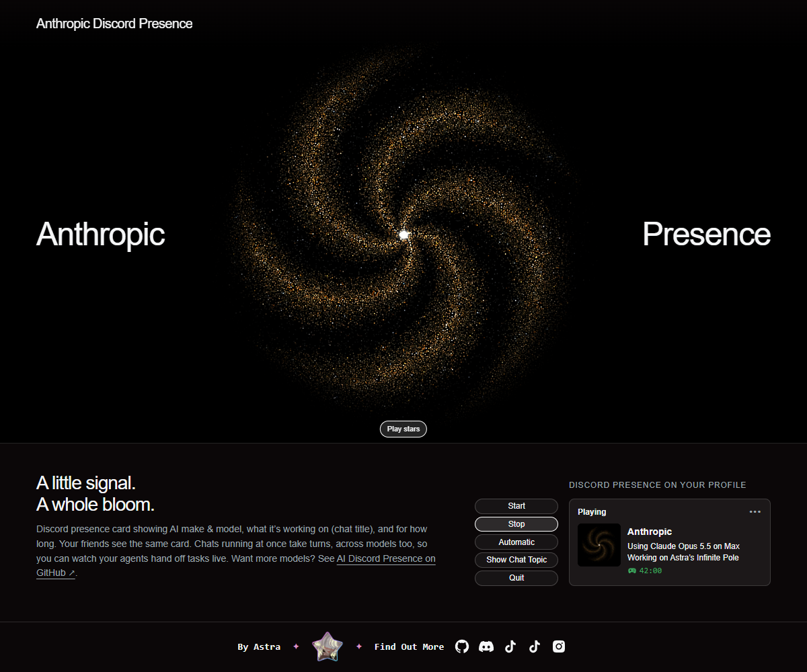

# Anthropic Discord Presence

*By Astra.* Show your Claude Code model on your Discord profile. A free Windows app.

<b><a href="https://github.com/findastra/ai-discord-presence/raw/main/downloads/anthropic-discord-presence.zip">⬇ Download for Windows</a></b>

**Needs:** Windows, [Node.js 24 or later](https://nodejs.org/en/download) and the Discord desktop app with activity
sharing on.

## The App

A small program on your PC. Its page opens in your browser and shows a live preview of your card.

## Getting Started

1. Install [Node.js 24 or later](https://nodejs.org/en/download) if needed.
2. Extract the download and double-click **Start Anthropic Discord Presence.cmd**.
3. Keep Discord desktop open with activity sharing on. Click **Automatic** for Claude Code, or **Start** for Claude on
   the web, desktop chat and cloud sessions.
4. Optional: double-click **Enable Automatic Startup.cmd** to start it with Windows.

What every button does, and the quirks:
[ai-discord-presence, Buttons & Instructions](https://github.com/findastra/ai-discord-presence#buttons--instructions).

## Developer Notes

1. **Where the code is:** the app is built and kept in
   [findastra/ai-discord-presence](https://github.com/findastra/ai-discord-presence/tree/main/anthropic-discord-presence),
   together with OpenAI Discord Presence. Report problems and send changes there.
2. **The first version** (Anthropic Presence, until 2026-10-17) is in this repo's history. If you still run it, choose
   **Quit app** in its control panel before starting the new one.

## Official Artwork

The official gold five-arm galaxy uses individually moving stars, a white center and black outer edges.
Approved by Astra on October 30, 2026. [Artwork and animation source](https://github.com/findastra/ai-discord-presence/blob/main/docs/official-galaxy-artwork-20261030.md).

## Credits

1. Built with Claude Opus 5.5, from 2026-10-06, together with the galaxy art and this page.
2. Full list: the "Built with" lines in
   [ai-discord-presence's AGENTS.md](https://github.com/findastra/ai-discord-presence/blob/main/AGENTS.md).

## License

MIT, see [LICENSE](LICENSE).

OpenAI, Codex, GPT, Anthropic, Claude and Discord are trademarks of their owners. This is an independent project, not
made, endorsed or sponsored by them; their names appear only to say which product you're using.
